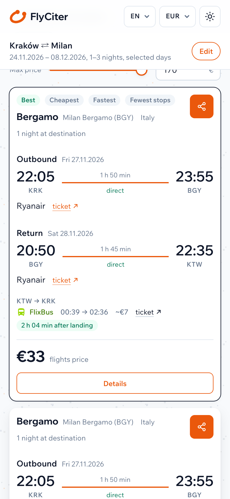
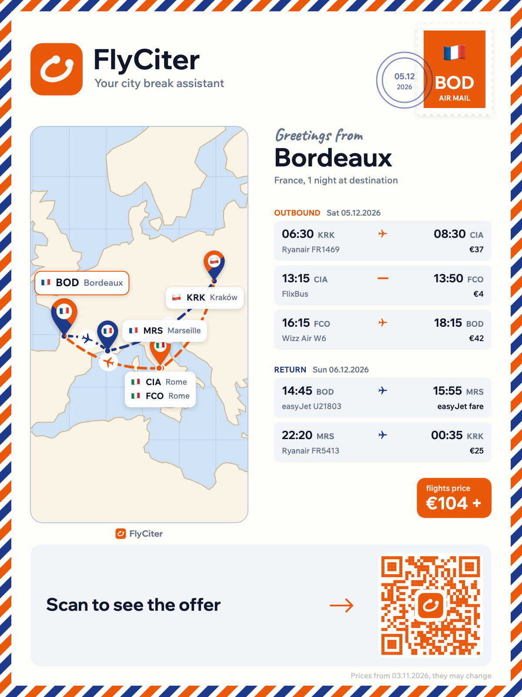

English | [Polski](README.pl.md)

# FlyCiter: cheap city break flights for a Friday-to-Monday weekend

[FlyCiter](https://flyciter.com) is a free flight search built for one kind of trip: leave after work on Friday, be home before Monday, and pay as little as possible for the flights in between. It compares Ryanair, Wizz Air and easyJet flights from all the airports within a radius you set, and when the cheap flight lands at the "wrong" airport, it finds the bus or train home.

This page walks through it with screenshots from the live site. The search itself runs at [flyciter.com](https://flyciter.com).

## Why are weekend flights Friday to Monday so hard to find by hand?

Take Kraków. Kraków airport (KRK) is the obvious place to fly from, but Katowice (KTW) is 67 km away and has its own Ryanair and Wizz Air flights. Milan has three airports, Linate, Bergamo and Malpensa, and the airlines spread their flights across them.

So "a weekend in Milan sometime this month" really means two departure airports, three arrival airports, two airline websites, and every Friday, Saturday and Sunday combination for each weekend. After that, a separate search for getting home from Katowice at midnight. Doing that in browser tabs gets old fast, which is why FlyCiter does it in one search.

## A real search: cheap flights from Kraków to Milan for a weekend

What we entered:

- **Weekend city break** mode. It sets a window, leave after Friday 17:00 and be home by Monday 03:00, with 1 to 3 nights away. Both ends of the window can be changed.
- **From:** Kraków, with **More airports** set to 100 km. That adds Katowice.
- **To:** Milan, which covers all three airports.
- **Dates:** 24 November to 8 December 2026, which holds two full weekends.

Below is what the live site returned on 3 November 2026. Fares change every day, so treat the numbers as an example.

FlyCiter checked 37 routes and found 60 trips.

The trip at the top:

- Friday 27 November, Ryanair, Kraków 22:05 → Bergamo 23:55, €16
- Saturday 28 November, Ryanair, Bergamo 20:50 → **Katowice** 22:35, €17

That's €33 for both flights. The return lands in Katowice rather than Kraków, so FlyCiter looked up the way home: a FlixBus at 00:39, in Kraków at 02:36, about €7, 2 h 04 min after landing (the framed row). Whether a bus after midnight is worth the saving is your decision. The search shows it to you instead of leaving you to discover it after booking.

Further down the same list were two nights away (Friday 4 to Sunday 6 December, back to Katowice) for €51, and a trip out with Ryanair and back with Wizz Air, both through Malpensa, for €65. Mixing airlines and airports like this is the reason to search them together.

## How does FlyCiter choose the airports near me?

Under **More options**, each side of the trip has a radius slider and the list of airports inside it, with distances. Here that's Kraków (0 km) and Katowice (67 km) at home, and Linate (15 km), Bergamo (38 km) and Malpensa (40 km) at the destination, where 50 km is the default radius. Any airport can be unticked, and you can add one by name.

Two of these settings do most of the work on weekend trips. **Arrival airports back home** is set to "Nearby airports too" by default, so the return may land anywhere within your home radius; that is how the €33 trip ends up in Katowice. **Return departure airports** is off by default. Move its slider (up to 600 km) and FlyCiter also tries flying home from a different city than the one you landed in, say into Barcelona and back from Valencia.

## Why compare Ryanair, Wizz Air and easyJet in one search?

On a route like Kraków to Milan they compete from different airports on different days, and no airline's website shows you the other airlines' flights. FlyCiter puts them in one list, so a Ryanair, Wizz Air and easyJet comparison is one search instead of three websites.

- **Ryanair and Wizz Air** fares come from the airlines' own websites, and the exact fare of each top result is checked again for the specific flight.
- **easyJet** flights sit in the same list, each with a **Check easyJet price** button that opens easyjet.com on that route and day. The Bordeaux example below has one.
- **Other airlines**, such as Vueling, Norwegian, Eurowings or Volotea, show up under **Routes only** wherever they fly a route the three don't.

Every booking button takes you straight to the airline's own website, with the route and date already filled in.

## How do self-transfer flights work?

Self-transfer flights in Europe usually mean two or more separate low-cost tickets that you connect yourself. It is often the only way to reach a city they don't fly to from your airport, and it is often cheaper than one ticket with a connection.

Bordeaux has no direct flight from Kraków or Katowice, so we ran the same weekend search there:

The top result leaves on Saturday 5 December:

- Ryanair, Kraków 06:30 → Rome Ciampino 08:30, €36
- a 4 h 45 min wait, then FlixBus from Ciampino 13:15 to Fiumicino 13:50, €4
- a 2 h 25 min wait, then Wizz Air, Fiumicino 16:15 → Bordeaux 18:15, €50

Coming back on Sunday it's easyJet from Bordeaux to Marseille (14:45 to 15:55), then Ryanair from Marseille at 22:20, landing in Kraków at 00:35 for €25. The card shows €111 for the Ryanair and Wizz Air flights, the €4 bus in its own row, and a **Check easyJet price** button for the easyJet leg.

Pointing at "2 stops" opens the chain with every wait, ending with the framed line: *Separate tickets: collect your bags and check in again.* Separate tickets mean the airlines don't wait for each other, so FlyCiter plans the connections with that in mind:

- By default it leaves at least 2 h 30 min between two flights on separate tickets. You can change this under **Advanced settings** as **Minimum connection time**.
- In the trip details every wait is coloured: green for plenty of time, grey for enough, red for a tight connection.
- Each ticket gets its own booking button, so you can count how many purchases the trip really is.

The ranking weighs price against time: by default it adds €3 for every hour of travel and €10 for every extra connection. Prefer shorter trips? Raise **Value of one hour of travel** under **Advanced settings** and the list reorders around your time.

## Multi-city flight search: two cities in one long weekend

The **Multi-city** tab takes a starting point, any number of cities and where the trip ends. We asked for Kraków → Barcelona and Valencia → Kraków, 2 to 4 nights in total, **In any order**. FlyCiter picked the order itself (Valencia first came out best) and split the nights:

- Sunday 29 November, Ryanair, Kraków → Valencia
- Monday 30 November, Valencia → Barcelona through Palma, on two Ryanair tickets (another self-transfer, 2 h 45 min in Palma)
- Tuesday 1 December, Ryanair, Barcelona → Kraków

The flights come to €106. Under the Valencia to Barcelona leg sits the framed line **or by bus: ~€18, ~6 h 06 min**, from the "Show trains and buses as an alternative to flights" option, which is on by default for multi-city trips. The bus is slower and cheaper and doesn't depend on two flights connecting on an island; the flight gets you there sooner. You see both and choose. Each city can also have its own minimum number of nights.

## On a phone

There's nothing to install. The site works in the phone's browser, in light and dark mode, in seven languages (English, Polish, German, French, Spanish, Italian and Ukrainian) and with prices in EUR, GBP, USD, PLN or CHF. **Share** on a trip copies a link to it, a text with the tickets, or a postcard image you can paste into a chat.

## What FlyCiter does not do

**It doesn't sell tickets.** Every booking button leads to the airline's or FlixBus's own website, and you buy there on their terms. No account, no booking fee, no commission. It shows no ads and has no affiliate or referral links: FlyCiter is a non-commercial project.

## FAQ

### Is FlyCiter free?

Yes. There's no account, no booking fee and no commission, and the site shows no ads and uses no analytics or tracking cookies (see the [FlyCiter privacy policy](https://flyciter.com/privacy.html)). You pay the airline directly.

### Can I search from several airports at once?

Yes, that is the main idea. Type your city in the [FlyCiter search form](https://flyciter.com), click **More airports** and set a radius. Every airport inside it is searched, and you can untick the ones you'd never use. The same works for the destination and for the airport you come home to.

### Can I search without a destination?

Turn on **Anywhere** next to the "To" field. FlyCiter then spreads its searches over everything the airlines fly from your airports in your dates, and shows at most three trips per destination, so the list is a spread of places rather than ten versions of one.

### Which airlines and transport does FlyCiter search?

Ryanair, Wizz Air and easyJet for flights, with routes of Vueling, Norwegian, Eurowings, Volotea and others where they fly. For the rides to and from airports and between cities it uses FlixBus and public rail and bus timetables.

### How does FlyCiter plan self-transfer connections?

It leaves at least 2 h 30 min between flights on separate tickets by default, marks each wait green, grey or red depending on how much time you have, and lets you raise the minimum under **Advanced settings**. Want only direct flights? Set **Flights each way** to **Direct only**.

### How fresh are the prices?

Fares come from the airlines' websites and are refreshed every few hours, and the exact fare of the top Ryanair results is checked again for the specific flight. You book on the airline's own site, at the price it shows.

## About FlyCiter

FlyCiter is an independent, non-commercial project, made for weekends like the ones above. It is not affiliated with Ryanair, Wizz Air, easyJet, FlixBus or any other carrier, and their names belong to their owners.

Questions or ideas? Open an issue in this repository or write to flyciter@gmail.com. Or just [try a weekend search on flyciter.com](https://flyciter.com).
