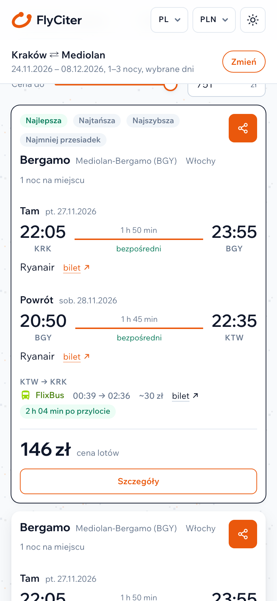
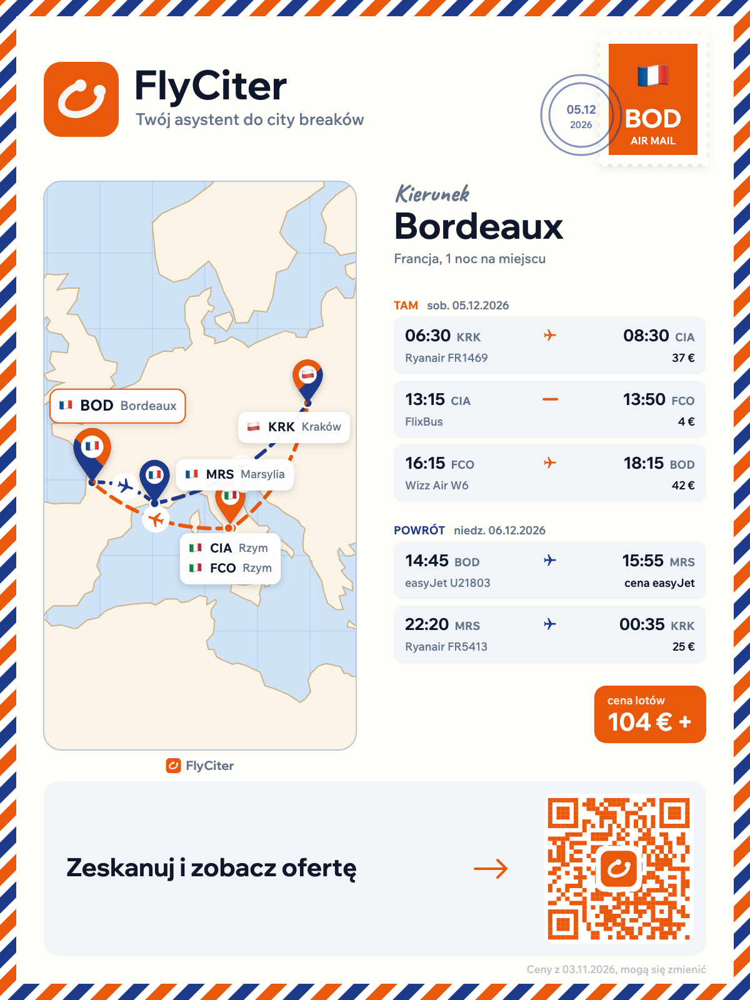

[English](README.md) | Polski

# FlyCiter: tanie loty na city break, w piątek wylot, w poniedziałek do pracy

[FlyCiter](https://flyciter.com) to darmowa wyszukiwarka tanich lotów na weekend i city break. Powstała z myślą o jednym konkretnym wyjeździe: wylot w piątek po pracy, powrót przed poniedziałkiem i jak najmniej wydane na bilety. Porównuje loty Ryanaira, Wizz Aira i easyJet ze wszystkich lotnisk w promieniu, który ustawiasz, a gdy tani lot ląduje na innym lotnisku niż to, z którego startujesz, szuka autobusu albo pociągu do domu.

Ta strona pokazuje ją na zrzutach z działającej wyszukiwarki. Sama wyszukiwarka działa pod adresem [flyciter.com](https://flyciter.com).

## Skąd problem z tanimi lotami na weekend?

Z Krakowa lata się z Balic (KRK), ale 67 km dalej są Katowice-Pyrzowice (KTW) z własnymi lotami Ryanaira i Wizz Aira. Mediolan ma trzy lotniska: Linate, Bergamo i Malpensę. Linie rozkładają loty między nie.

Pytanie „gdzieś w tym miesiącu na weekend do Mediolanu” to w praktyce dwa lotniska wylotu, trzy lotniska przylotu, dwie strony przewoźników i każda kombinacja piątku, soboty i niedzieli w każdym weekendzie. Na koniec osobne szukanie, jak wrócić z Pyrzowic o północy. Klikanie tego w kartach przeglądarki szybko się nudzi, dlatego FlyCiter robi to w jednym wyszukiwaniu.

## Przykład: tanie loty z Krakowa do Mediolanu na weekend

Co wpisujemy:

- tryb **Weekendowy city break**, czyli okno „wylot od piątku 17:00, w domu do poniedziałku 03:00” i od 1 do 3 nocy na miejscu (obie granice da się przesunąć),
- **Skąd:** Kraków, a w „Więcej lotnisk” promień 100 km, co dokłada Katowice,
- **Dokąd:** Mediolan, czyli od razu wszystkie trzy lotniska,
- **Daty:** od 24 listopada do 8 grudnia 2026, a więc dwa pełne weekendy.

Wyniki poniżej pochodzą z działającej strony z 3 listopada 2026. Ceny lotów zmieniają się codziennie, więc to przykład działania, a nie oferta.

FlyCiter sprawdził 37 tras i znalazł 60 podróży.

Na górze listy:

- piątek 27 listopada, Ryanair, Kraków 22:05 → Bergamo 23:55, 71 zł,
- sobota 28 listopada, Ryanair, Bergamo 20:50 → **Katowice** 22:35, 75 zł.

Razem 146 zł za oba loty. Powrót ląduje w Katowicach, więc FlyCiter od razu szuka dojazdu: FlixBus o 00:39, w Krakowie o 02:36, około 30 zł, 2 h 04 min po wylądowaniu (to wiersz w ramce). Czy autobus po północy jest wart tej różnicy w cenie, to już Twoja decyzja. Ważne, że widzisz go przed zakupem biletu, a nie po.

Niżej na tej samej liście są też dwie noce (od piątku 4 do niedzieli 6 grudnia, z powrotem do Katowic) i wariant tam Ryanairem, z powrotem Wizz Airem, oba przez Malpensę. Dla takich połączeń linii i lotnisk w ogóle warto szukać wszystkiego naraz.

## Jak szukać lotów z kilku lotnisk w okolicy?

W **Więcej opcji** każda strona podróży ma suwak promienia i listę lotnisk w tym promieniu, z odległościami. Tutaj to Kraków (0 km) i Katowice (67 km) po stronie domu oraz Linate (15 km), Bergamo (38 km) i Malpensa (40 km) po stronie Mediolanu, gdzie domyślny promień to 50 km. Każde lotnisko można odznaczyć albo dopisać nowe z nazwy.

Przy weekendach najwięcej robią dwa ustawienia. **Lotniska przylotu do domu** są domyślnie ustawione na **Także pobliskie**, więc samolot do domu może wylądować na dowolnym lotnisku w promieniu od domu. Stąd powrót do Katowic w przykładzie za 146 zł. **Lotniska wylotu powrotnego** są domyślnie wyłączone. Po przesunięciu suwaka (do 600 km) FlyCiter szuka też powrotu z innego miasta niż to, do którego przylatujesz, na przykład tam do Barcelony, z powrotem z Walencji. Ten wariant jest zresztą jednym z przykładów na stronie głównej.

## Wyszukiwarka tanich lotów Ryanair, Wizz Air i easyJet w jednym miejscu

Na trasie Kraków–Mediolan te linie naprawdę konkurują, z różnych lotnisk i w różne dni, a strona żadnej z nich nie pokaże lotów pozostałych. FlyCiter zbiera je w jedną listę, więc porównanie Ryanaira, Wizz Aira i easyJet to jedno wyszukiwanie zamiast trzech stron.

- **Ryanair i Wizz Air:** ceny prosto ze stron przewoźników, a dla najlepszych wyników FlyCiter sprawdza jeszcze raz dokładną cenę konkretnego lotu.
- **easyJet:** loty na tej samej liście, każdy z przyciskiem **Sprawdź cenę easyJet**, który otwiera easyjet.com od razu na tej trasie i w ten dzień. Taki przypadek jest w przykładzie z Bordeaux niżej.
- **Inne linie**, jak Vueling, Norwegian, Eurowings czy Volotea, pojawiają się w sekcji **Tylko trasy** wszędzie tam, gdzie latają, a tamte trzy nie.

Każdy przycisk rezerwacji prowadzi prosto na stronę przewoźnika, z trasą i datą już wpisanymi.

## Jak działają loty z przesiadką na osobnych biletach (self-transfer)?

Self-transfer to dwa albo więcej osobnych biletów, które łączy się samodzielnie. Z tanimi liniami bywa to jedyny sposób, żeby dolecieć tam, dokąd z Twojego lotniska nikt nie lata, i często wychodzi taniej niż jeden bilet z przesiadką.

Do Bordeaux nie ma lotu bezpośredniego ani z Krakowa, ani z Katowic, więc to samo wyszukiwanie weekendowe pokazuje takie połączenie:

Pierwszy wynik, sobota 5 grudnia:

- Ryanair, Kraków 06:30 → Rzym Ciampino 08:30,
- 4 h 45 min czekania i FlixBus z Ciampino o 13:15 na Fiumicino o 13:50, 18 zł,
- 2 h 25 min czekania i Wizz Air, Fiumicino 16:15 → Bordeaux 18:15.

W niedzielę powrót easyJetem z Bordeaux do Marsylii (14:45–15:55), potem Ryanairem z Marsylii o 22:20, w Krakowie o 00:35. Na karcie jest 490 zł za loty Ryanaira i Wizz Aira, autobus w osobnym wierszu i przycisk **Sprawdź cenę easyJet** dla odcinka easyJet.

Po najechaniu na „2 przesiadki” widać cały łańcuch z czasami oczekiwania, a na końcu zdanie w ramce: *Osobne bilety: odbierz bagaż i odpraw się ponownie.* Przy osobnych biletach linie nie czekają na siebie nawzajem, więc FlyCiter planuje przesiadki z zapasem:

- domyślnie zostawia co najmniej 2 h 30 min między lotami na osobnych biletach (**Minimalny czas przesiadki** w **Ustawieniach zaawansowanych**),
- w szczegółach podróży koloruje każdą przesiadkę: zielona to dużo czasu, szara to czasu wystarczy, czerwona to mało czasu na przesiadkę,
- każdy bilet ma osobny przycisk rezerwacji, więc od razu widać, ile zakupów kryje się za jedną podróżą.

Ranking waży cenę i czas: domyślnie dolicza równowartość 3 euro za każdą godzinę w drodze i 10 euro za każdą dodatkową przesiadkę. Wolisz krótsze podróże? Podnieś **Wartość godziny podróży** w **Ustawieniach zaawansowanych**, a lista ułoży się pod Twój czas.

## Wyszukiwarka lotów przez kilka miast

Zakładka **Wiele miast** przyjmuje punkt startu, dowolną liczbę miast i miejsce, gdzie podróż ma się skończyć. Wpisujemy Kraków → Barcelona i Walencja → Kraków, od 2 do 4 nocy łącznie, **W dowolnej kolejności**. Kolejność FlyCiter dobiera sam (najpierw Walencja wyszła najlepiej) i sam dzieli noce:

- niedziela 29 listopada, Ryanair, Kraków → Walencja,
- poniedziałek 30 listopada, Walencja → Barcelona przez Palmę, na dwóch biletach Ryanaira (czyli znowu self-transfer, 2 h 45 min na Majorce),
- wtorek 1 grudnia, Ryanair, Barcelona → Kraków.

Loty kosztują razem 468 zł. Pod odcinkiem Walencja–Barcelona jest linia w ramce: **albo autobus: ~81 zł, ~6 h 06 min**. Daje ją opcja „Pokaż pociągi i autobusy jako alternatywę dla samolotów”, w podróżach przez kilka miast domyślnie włączona. Autobus jest wolniejszy, tańszy i nie zależy od tego, czy zdążysz na drugi samolot na wyspie. Samolot dowiezie Cię szybciej. Widzisz obie opcje i wybierasz. Każde miasto może też mieć własną minimalną liczbę nocy.

## Na telefonie

Nie trzeba nic instalować. Strona działa w przeglądarce telefonu, w trybie jasnym i ciemnym, w siedmiu językach (polski, angielski, niemiecki, francuski, hiszpański, włoski, ukraiński) i z cenami w PLN, EUR, GBP, USD lub CHF. **Udostępnij** przy podróży kopiuje link do niej, opis z biletami albo obrazek w formie pocztówki, który można wkleić na czacie.

## Czego FlyCiter nie robi

**Nie sprzedaje biletów.** Każdy przycisk rezerwacji prowadzi na stronę przewoźnika albo FlixBusa i tam kupujesz bilet na jego warunkach. Bez konta, opłat i prowizji. Strona nie wyświetla reklam i nie ma linków partnerskich ani afiliacyjnych: FlyCiter to projekt niekomercyjny.

## Najczęstsze pytania

### Czy FlyCiter jest darmowy?

Tak. Nie ma konta, opłat rezerwacyjnych ani prowizji, a strona nie wyświetla reklam i nie używa analityki ani śledzących ciasteczek (zobacz [politykę prywatności FlyCiter](https://flyciter.com/privacy.html)). Za bilet płacisz bezpośrednio przewoźnikowi.

### Czy da się szukać lotów z kilku lotnisk naraz, np. tanich lotów z Krakowa i Katowic?

Tak, po to ta wyszukiwarka powstała. Wpisz miasto w [formularzu wyszukiwarki FlyCiter](https://flyciter.com), kliknij **Więcej lotnisk** i ustaw promień. Przeszukane zostaną wszystkie lotniska w tym promieniu, a te, z których nigdy nie latasz, możesz odznaczyć. Tak samo działa to po stronie celu i dla lotniska, na które wracasz.

### Czy mogę szukać bez celu podróży?

Włącz **Dokądkolwiek** przy polu „Dokąd”. FlyCiter rozkłada wtedy wyszukiwanie na wszystko, dokąd linie latają z Twoich lotnisk w Twoich terminach, i pokazuje najwyżej trzy podróże do jednego miejsca, żeby lista była przeglądem miast, a nie dziesięcioma wariantami jednego.

### Jakie linie i przejazdy przeszukuje FlyCiter?

Ryanair, Wizz Air i easyJet, a do tego trasy Vuelinga, Norwegiana, Eurowings, Volotei i innych linii tam, gdzie latają. Dojazdy na lotnisko, z lotniska i między miastami bierze z FlixBusa oraz publicznych rozkładów kolei i autobusów.

### Jak FlyCiter planuje przesiadki na osobnych biletach?

Domyślnie zostawia co najmniej 2 h 30 min między lotami na osobnych biletach, każde oczekiwanie koloruje na zielono, szaro albo czerwono zależnie od zapasu czasu i pozwala podnieść minimum w **Ustawieniach zaawansowanych**. Chcesz tylko loty bezpośrednie? Ustaw **Loty w każdą stronę** na **Tylko bezpośrednie**.

### Jak aktualne są ceny?

Ceny pochodzą ze stron przewoźników i odświeżają się co kilka godzin, a dla najlepszych wyników Ryanaira dokładna cena konkretnego lotu jest sprawdzana jeszcze raz. Rezerwujesz na stronie przewoźnika, po cenie, którą tam widzisz.

## O FlyCiter

FlyCiter to niezależny, niekomercyjny projekt, robiony z myślą o takich weekendach jak powyżej. Nie jest powiązany z Ryanairem, Wizz Airem, easyJetem, FlixBusem ani żadnym innym przewoźnikiem, a ich nazwy należą do właścicieli.

Pytania albo pomysły? Załóż issue w tym repozytorium albo napisz na flyciter@gmail.com. Albo po prostu [poszukaj taniego lotu na weekend na flyciter.com](https://flyciter.com).
